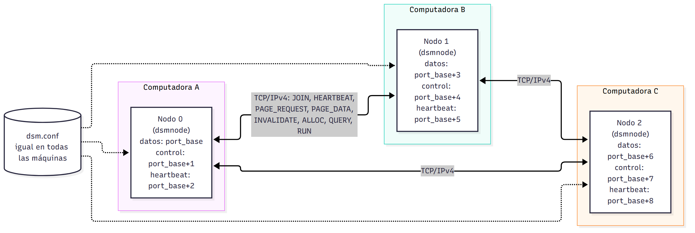
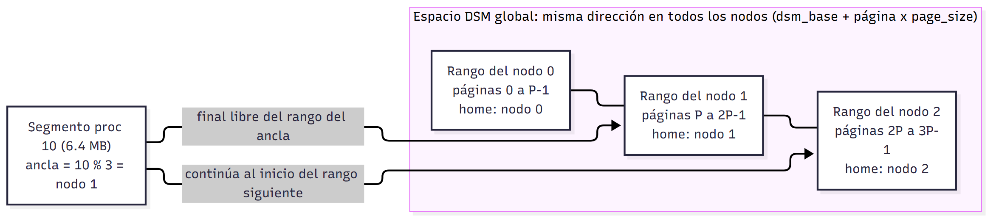
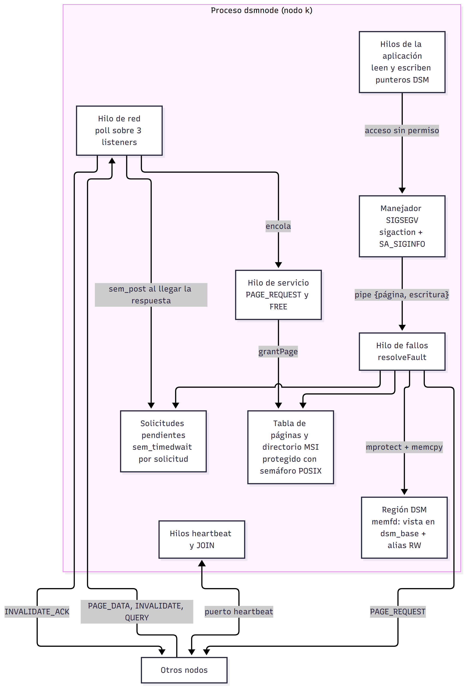
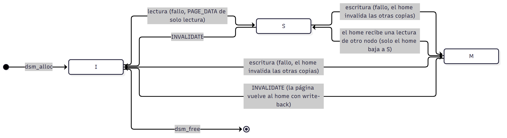
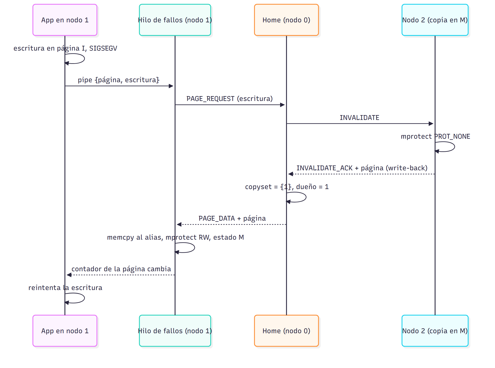

# 1. Introducción

El proyecto construye un sistema de Memoria Compartida Distribuida (DSM) en espacio de usuario para Linux [1]. Varios procesos, en la misma computadora o en computadoras distintas, ven un único rango de direcciones virtuales. Cuando un proceso toca una página que no tiene, el procesador genera un fallo de página. El DSM pide la página por la red al nodo que la administra y la instrucción se repite. La idea sigue la memoria virtual compartida de Li y Hudak [2] y reutiliza la paginación bajo demanda del sistema operativo [3].

El código está en la carpeta `EntregaFinal` del repositorio https://github.com/Serzc/Proyecto_SO. Está escrito en C++17 con un API en C (`dsm.h`). Las aplicaciones de prueba están escritas en C y solo usan ese API.

# 2. Arquitectura

## 2.1 Nodos y conexiones

{width=80%}

Un nodo es un proceso `dsmnode`. Todos los nodos son iguales: no hay servidor, coordinador ni maestro (Figura 1). Todos leen el mismo `dsm.conf`, y la posición de cada línea `host` define el `node_id`. Cada nodo abre tres puertos TCP sobre IPv4: datos (`port_base + 3k`), control (`port_base + 3k + 1`) y heartbeat (`port_base + 3k + 2`). Los latidos van por su propio puerto para que una transferencia de páginas no los retrase. Cada frame usa una conexión TCP corta: el emisor conecta, envía y cierra; el receptor atiende todas las conexiones con un solo `poll`.

Al arrancar, cada nodo envía `JOIN` a todos los hosts con los parámetros de su `dsm.conf` y la IPv4 de cada host, que también dicen cuánta memoria aporta cada nodo y dónde está. El que lo recibe los compara con su propia configuración. Si no coinciden, responde con error, marca al nodo como CAÍDO, ignora sus mensajes y lo anuncia en `monitor`. Así una máquina con otra configuración no puede calcular homes distintos y corromper la memoria. Después, cada `heartbeat_ms` todos envían `HEARTBEAT`; un nodo que pasa `timeout_ms` en silencio queda CAÍDO hasta que vuelve a hablar.

## 2.2 Espacio de direcciones y segmentos

{width=85%}

El espacio DSM tiene `num_hosts × pages_per_node` páginas numeradas globalmente. La página p vive en la dirección `dsm_base + p × page_size` en todos los nodos, así que un puntero guardado en memoria compartida vale en cualquier nodo. El home de la página p es el nodo `p / pages_per_node`. Es el administrador distribuido fijo de Li y Hudak [2]: cada nodo administra la memoria que aporta y nadie tiene que buscar quién administra una página.

La memoria se pide por segmentos compartidos, como con `shm_open`: `dsm_alloc(size, proc, &ptr)` con el mismo `proc` devuelve la misma región en cualquier nodo. El ancla del segmento es el nodo `proc % nodos`. Si el segmento no cabe ahí, el ancla toma las páginas libres del final de su rango y el segmento sigue al principio del rango del nodo siguiente, con la dirección continua (Figura 2). Así se cumple que un nodo pida memoria a los demás cuando la suya no alcanza. Cada home guarda qué nodos están unidos a su parte, y el último que la suelta la libera.

## 2.3 Hilos de un nodo

{width=42%}

Las aplicaciones corren dentro del proceso `dsmnode`, porque `SIGSEGV` y `mprotect` solo actúan sobre el propio proceso. La consola las inicia con `run` (Figura 3). Un nodo tiene estos hilos (pthreads, a través de `std::thread`):

| Hilo | Función |
|---|---|
| Aplicación | Ejecutan la app con 4 pthreads; usan punteros DSM como memoria normal y generan los fallos |
| Fallos | Recibe los fallos por un pipe, uno a la vez, los resuelve con el home y aplica `mprotect` |
| Red | Un `poll` sobre los tres listeners y las conexiones aceptadas; valida y despacha cada frame. Nunca espera a otro nodo |
| Servicio | Atiende `PAGE_REQUEST` y `FREE`, que pueden esperar invalidaciones de otros nodos |
| Heartbeat y JOIN | Envían latidos, marcan nodos caídos y anuncian el nodo a los pares que no respondieron |
| Consola | Comandos `nodes`, `stats`, `pages`, `run` y `monitor` |

# 3. Cambios respecto al Entregable 1

**Asignación como segmento compartido.** El Entregable 1 daba a cada `dsm_alloc` una región privada del nodo que la pedía, buscando primero en el rango local, y la limitaba a `pages_per_node` páginas. Para que varios nodos trabajen sobre los mismos datos, cada uno tenía que recibir de alguna forma la dirección que obtuvo otro. Ahora el número de proceso identifica el segmento, y todos los nodos que lo piden reciben la misma región. El home cuenta los nodos unidos y libera las páginas cuando sale el último.

**Segmentos que ocupan varios nodos.** El límite de un rango por asignación dejaba sin cumplir el punto del enunciado en que un nodo pide memoria a otros cuando la suya no alcanza. El segmento ahora continúa en el rango del nodo siguiente. `ALLOC_REQUEST` ganó una segunda forma, la de continuación, que pide páginas exactas al inicio del rango.

**El manejador de SIGSEGV ya no espera en un semáforo.** El diseño original enviaba la solicitud desde el manejador y esperaba ahí con `sem_wait`. Enviar por un socket y tomar mutex no es seguro dentro de un manejador de señales. Ahora el manejador solo escribe la página en un pipe y espera un contador atómico; el hilo de fallos hace el trabajo. El hilo afectado sigue pausado mientras tanto, como pide el enunciado.

**Un semáforo para todo el directorio.** El Entregable 1 tenía 64 mutex de home (`home_lock[64]`). Con uno solo es más simple razonar sobre interbloqueos, y la contención no se notó en las pruebas. Es un semáforo POSIX binario (`directory_sem_`).

**Write-back en la invalidación.** `INVALIDATE_ACK` lleva el contenido de la página si el nodo la tenía en M. Así el home recupera la versión más reciente en el mismo viaje, sin un `PAGE_REQUEST` aparte al dueño.

**Mensajes nuevos.** `FREE_REPLY` separa la respuesta de liberar de la de asignar. `QUERY_REQUEST` ganó un tercer tipo para leer el log de solicitudes de un home. `RUN_REQUEST` permite lanzar una aplicación en todos los nodos desde uno solo.

**Caída de un nodo.** El diseño original terminaba el proceso. Ahora la operación devuelve `DSM_E_TIMEOUT` o `DSM_E_NODE_DOWN`, y la consola sigue funcionando.

**Lo que se mantuvo.** La red de pares sin coordinador, el home fijo por rango, los tres puertos por nodo, el encabezado de 16 bytes, la validación de configuración en el `JOIN`, la doble proyección del `memfd` y los estados M, S e I sin estados extra.

# 4. Memoria virtual y paginación bajo demanda

Al iniciar, el nodo crea un `memfd` del tamaño de todo el espacio DSM y lo proyecta dos veces con `mmap` [4]. La vista de las aplicaciones queda en `dsm_base` con `MAP_FIXED_NOREPLACE` y `PROT_NONE`. La segunda vista es un alias de lectura y escritura que solo usa el nodo para copiar páginas que llegan o salen sin abrir la protección de la vista pública. Solo ocupan memoria física las páginas que se tocan.

Cada estado MSI se traduce a una protección con `mprotect`: I es `PROT_NONE`, S es `PROT_READ` y M es `PROT_READ | PROT_WRITE`. Es la paginación bajo demanda del curso aplicada a la red: en vez de traer la página del disco, el manejador de fallos la trae de otro nodo.

El manejador se instala con `sigaction` y `SA_SIGINFO`. Lee la dirección exacta de `si_addr`, calcula la página y sabe si fue escritura por el bit de escritura del registro de error (`REG_ERR`, x86_64). Si la dirección no es del DSM, restaura el manejador anterior y el proceso termina con un segmentation fault normal. Si es del DSM, solo usa operaciones async-signal-safe: escribe `{página, escritura}` en un pipe y espera con `nanosleep` a que cambie el contador atómico de esa página. El hilo de fallos resuelve el fallo, cambia la protección e incrementa el contador. El manejador retorna y el CPU repite la instrucción, que ahora tiene permiso.

# 5. Coherencia MSI

{width=80%}

El protocolo usa un directorio en el home e invalidación con write-back (Figura 4). Para cada página, el home guarda el dueño (el nodo con la versión más reciente) y el copyset (un bit por nodo con copia válida). La función `grantPage` atiende cada solicitud bajo el semáforo del directorio:

1. Si otro nodo tiene la página en M, el home le envía `INVALIDATE`. Ese nodo baja a I y devuelve el contenido en `INVALIDATE_ACK`.
2. En una lectura, el solicitante entra al copyset. Si el home tenía la página en M, baja a S.
3. En una escritura, el home invalida todas las demás copias, la suya incluida, y deja al solicitante como dueño único.
4. El home responde `PAGE_DATA` con la página, y el solicitante la copia por el alias y aplica S o M.

{width=58%}

Como cada frame usa su propia conexión, un `INVALIDATE` puede llegar antes que el `PAGE_DATA` que revoca. Para cubrirlo, el hilo de fallos marca la página como "en solicitud" antes de pedirla. Si llega un `INVALIDATE` mientras tanto, el `PAGE_DATA` se descarta y el acceso vuelve a fallar.

Cuando un nodo hace `dsm_free` y otros siguen unidos, el home recupera sus copias, con write-back de las que tenía en M, porque ese nodo puede salir del sistema. Cuando sale el último, el home invalida todas las copias y llena las páginas con ceros. `dsm_shutdown` espera, hasta `timeout_ms`, a que ningún nodo en línea siga usando un segmento cuyo home es el nodo que sale.

# 6. Protocolo de mensajes

Cada frame es un encabezado de 16 bytes seguido de la carga: `type` (1 byte), `sender` (1), `status` (1), `flags` (1), `seq` (4), `page` (4) y `payload_len` (4), en orden de red. El receptor valida el emisor, la IP de origen, el canal, el tipo, el estado, la página y el largo exacto de la carga para ese tipo; un frame inválido se descarta. Las respuestas repiten el `seq` de la solicitud. `status` vale 0 (bien), 1 (sin espacio) o 2 (inválido), y una respuesta con error no lleva carga.

| Mensaje (código) | Dirección | Carga | Errores |
|---|---|---|---|
| `JOIN` (1) / `JOIN_ACK` (2) | nodo nuevo a cada par | 28 bytes de parámetros y 4 por host (IPv4) / ninguna | `JOIN_ACK` inválido si la configuración no coincide; el emisor queda CAÍDO |
| `HEARTBEAT` (3) | todos a todos, puerto heartbeat | ninguna | ninguno; el silencio marca CAÍDO |
| `PAGE_REQUEST` (4) / `PAGE_DATA` (5) | solicitante a home / home a solicitante | 4 bytes: 0 lectura, 1 escritura / la página | inválido si la página no está asignada o no es de ese home (`DSM_E_BADADDR`) |
| `INVALIDATE` (6) / `INVALIDATE_ACK` (7) | home a nodo con copia / respuesta | ninguna / la página si estaba en M | sin respuesta: el home da la copia por perdida |
| `ALLOC_REQUEST` (8) / `ALLOC_REPLY` (9) | nodo a home | cantidad y proceso (8 bytes), más primera página y orden en una continuación (16) / primera página y páginas tomadas | sin espacio (`DSM_E_NOMEM`), inválido |
| `FREE` (10) / `FREE_REPLY` (13) | nodo a home | primera página, cantidad y proceso | inválido si no es una asignación de ese proceso (`DSM_E_BADADDR`) |
| `QUERY_REQUEST` (11) / `QUERY_REPLY` (12) | cualquiera a nodo consultado | tipo (estadísticas, páginas o log), primera página y cantidad / 32 bytes, o 16 por página o entrada | inválido si el rango o el tipo no existen (`DSM_E_INVAL`) |
| `RUN_REQUEST` (14) | nodo origen a cada nodo | texto `run <app>` | sin respuesta; la app reporta sus errores |

Si una respuesta no llega antes de `timeout_ms`, la operación devuelve `DSM_E_TIMEOUT`. Si el destino está caído, devuelve `DSM_E_NODE_DOWN`.

# 7. Concurrencia, sincronización e interbloqueos

Las estructuras compartidas entre los hilos de usuario que fallan y el hilo de red se protegen con semáforos POSIX y mutex. El directorio MSI se protege con un semáforo binario (`sem_init(&directory_sem_, 0, 1)`), que se toma con `sem_wait` y se suelta con `sem_post` a través de la clase `SemaphoreLock`. Cada solicitud pendiente tiene su propio `sem_t`: el hilo que pide espera con `sem_timedwait` hasta `timeout_ms`, y el hilo de red hace `sem_post` cuando llega la respuesta con el mismo `seq`. La tabla de páginas, la de nodos, la de asignaciones y la cola del hilo de servicio usan mutex. Entre el manejador de señales y el hilo de fallos solo hay un pipe y contadores atómicos sin locks.

Para que haya un interbloqueo deben cumplirse las cuatro condiciones de Coffman [3]: exclusión mutua, retener y esperar, sin expropiación y espera circular. El diseño rompe la espera circular con tres reglas:

1. **El hilo de red nunca espera a otro nodo.** Todas las respuestas llegan por ese hilo; si se bloqueara, nadie las entregaría. Por eso `INVALIDATE` y `QUERY_REQUEST` se responden en el acto con datos locales, y `PAGE_REQUEST` y `FREE`, que pueden necesitar invalidaciones, pasan al hilo de servicio.
2. **Las esperas entre nodos tienen una sola dirección.** Un nodo espera a un home por una página, y un home espera a otros nodos por invalidaciones, pero las invalidaciones las responde un hilo de red, que no espera a nadie.
3. **Orden fijo de locks.** Primero el semáforo del directorio, después el mutex de la tabla de páginas y al final el de la tabla de nodos. Ningún hilo espera a la red mientras tiene el mutex de la tabla de páginas, y el manejador de señales no toma ninguno.

Además, toda espera por la red tiene un tope de `timeout_ms`, así que un nodo caído no deja hilos bloqueados para siempre.

# 8. Estructuras de datos

| Estructura | Tamaño | Contenido |
|---|---|---|
| `MsgHeader` | 16 B | Encabezado de cada frame |
| `NodeInfo` (`dsm_node_t`) | 16 B | IPv4, primera página, cantidad de páginas, `node_id` y estado |
| `PageEntry` (`dsm_page_t`) | 16 B | Proceso, copyset, orden dentro del segmento, estado MSI local y dueño |
| `NodeStats` (`dsm_stats_t`) | 32 B | Páginas totales y libres, copias en M/S/I, fallos, páginas enviadas y recibidas |
| `Config` | 2080 B | Parámetros de `dsm.conf` y hasta 32 hosts |
| `Allocation` | 20 B | Primera página, cantidad, proceso, nodos unidos y tamaño total del segmento |
| `LogEntry` | 16 B | Hora, página, nodo, tipo de solicitud, resultado y write-back; 64 por home |
| `Pending` | variable | Solicitud en espera: `seq`, destino, tipo de respuesta, `sem_t` y carga recibida |

La tabla de páginas tiene una entrada por página del sistema. En las páginas de las que el nodo es home, la entrada también es el directorio; en las demás solo importa el estado de la copia local.

# 9. API

Todas las funciones devuelven 0 o un valor positivo si tienen éxito, y un código negativo si fallan. `dsm_strerror` lo convierte en texto.

| Función | Entradas | Salida | Errores |
|---|---|---|---|
| `int dsm_init(const char* config_path, int node_id)` | ruta de `dsm.conf`; posición del nodo en la lista `host` | 0 | `INVAL` (id fuera de la lista o nodo ya iniciado), `CONFIG` (archivo inválido), `NET` (no puede abrir puertos o reservar la región), `NOMEM` |
| `void dsm_shutdown(void)` | ninguna | ninguna | ninguno; espera a los nodos unidos a sus segmentos hasta `timeout_ms` |
| `int dsm_alloc(size_t size, uint16_t proc, void** ptr)` | bytes (se redondean a páginas); número de segmento, 1 a 65535 | 0 y la dirección en `*ptr` | `INVAL` (tamaño 0, `proc` 0 o sin `dsm_init`), `NOMEM` (no hay espacio en el sistema), `NODE_DOWN`, `TIMEOUT`, `NET` |
| `int dsm_free(void* ptr)` | dirección devuelta por `dsm_alloc` | 0 | `BADADDR` (no es el inicio de un segmento), `INVAL`, `TIMEOUT` |
| `int dsm_nodes(dsm_node_t* out, int max)` | arreglo y su capacidad | nodos copiados | `INVAL` |
| `int dsm_stats(int node_id, dsm_stats_t* out)` | nodo consultado | 0 | `INVAL`, `NODE_DOWN`, `TIMEOUT` |
| `int dsm_page_table(int node_id, uint32_t first, uint32_t count, dsm_page_t* out)` | home consultado, primera página y cantidad (hasta 256) | entradas copiadas | `INVAL`, `NODE_DOWN`, `TIMEOUT` |
| `void* dsm_page_address(uint32_t page)` | número de página global | dirección, o NULL | ninguno |
| `size_t dsm_page_size(void)` | ninguna | tamaño de página | ninguno |
| `const char* dsm_strerror(int err)` | código | texto fijo | ninguno |

Los códigos son `DSM_OK` (0), `DSM_E_INVAL` (-1), `DSM_E_CONFIG` (-2), `DSM_E_NOMEM` (-3), `DSM_E_BADADDR` (-4), `DSM_E_NODE_DOWN` (-5), `DSM_E_TIMEOUT` (-6) y `DSM_E_NET` (-7). `DSM_E_NOT_IMPLEMENTED` (-8) queda reservado y ninguna función lo devuelve. Un acceso a una página no asignada, o cuyo home no responde, no devuelve error: termina el proceso con `SIGSEGV`, como un puntero inválido.

# 10. Aplicaciones de prueba

Una corrida se lanza desde la consola de un solo nodo, el que tiene los archivos de entrada; cualquier nodo puede hacerlo. Ese nodo es el origen: envía `RUN_REQUEST` a los demás, que ejecutan la misma app sin archivos. Es la ejecución distribuida de procesos del primer extra del enunciado. Las tres aplicaciones siguen el mismo esquema:

1. Todos se unen a un segmento de información de una página. El origen lee los archivos y publica los tamaños de la entrada, o cancela la corrida si el archivo no existe o no cabe.
2. Todos se unen a los segmentos de datos. El origen copia la entrada al DSM.
3. Cada nodo calcula su parte con 4 pthreads y lee la entrada por el DSM. Las páginas que no tiene le llegan por la red, así que los archivos solo tienen que estar en la máquina del origen.
4. El origen compara el resultado con el mismo cálculo hecho en forma secuencial, lo guarda en `output/` y publica el veredicto.

Entre los pasos hay barreras: cada nodo anota su fase en su propia página de control y lee las de los demás. Cuando otro nodo escribe su fase, la invalidación MSI obliga a pedir la página otra vez, así que la coherencia del DSM basta para sincronizar.

**`wordcount`** cuenta palabras, líneas y letras de un texto, como `wc` de Unix y el ejemplo clásico de MapReduce [5]. Cada nodo cuenta su tramo de bytes; una palabra cuenta en el tramo donde empieza. Archivos: el enunciado en texto plano (15 905 bytes) y el mismo texto repetido 400 veces (6.4 MB).

**`matmul`** calcula C = A × B con el algoritmo de tres ciclos, repartido por bloques de filas [6]. Cada nodo calcula sus filas de C y lee B completa por el DSM. Las filas de C que comparten una página obligan a invalidaciones y write-back entre nodos. Archivos: dos matrices de 96 × 96.

**`imgfilter`** convierte una foto PPM a un dibujo a lápiz: escala de grises, magnitud del gradiente con el operador de Sobel [7], [8] e inversión. La imagen se reparte en bandas de filas, cada una en su propio segmento; en los bordes de su banda cada nodo lee filas de otra. La foto de prueba es "Aldrin Apollo 11" de la NASA, de dominio público (1280 × 1288, 6.4 MB en el DSM entre entrada y salida).

Los algoritmos se adaptaron al DSM sin cambiar su lógica: los arreglos que antes venían de `malloc` ahora vienen de `dsm_alloc`, el trabajo se reparte por nodo y por hilo, y se agregaron las barreras y la verificación.

# 11. Pruebas y resultados

`make test` corre dos pruebas automáticas. `test_memoria` usa un nodo y comprueba los cambios I, S y M, que los accesos con permiso no fallan y que liberar deja las páginas en I y en cero. `test_coherencia` usa dos procesos: lectura remota, escritura con write-back, invalidación, consultas por la red y un segmento de 20 páginas repartido entre los dos nodos, leído y escrito a ambos lados del límite.

Con tres nodos y lanzando desde uno solo, las tres aplicaciones dieron el resultado esperado: `wordcount` 2180 palabras y 246 líneas; `matmul` con suma de C igual a 9787.8401 (0 de 9216 celdas distintas a la versión secuencial); `imgfilter` con 0 de 1 648 640 píxeles distintos. También se probó lanzar desde el nodo 2, un archivo inexistente (los demás nodos informan que el origen canceló) y un nodo con un `dsm.conf` distinto (los demás lo rechazan y queda CAÍDO).

`make bench` corre las tres aplicaciones con 1, 2 y 3 nodos en una misma computadora, con 4 MB y 4 pthreads por nodo y el nodo 0 como origen. La carga va desde que el origen publica los tamaños hasta que la entrada está en el DSM; el cálculo distribuido va entre la primera y la segunda barrera. Resultados del nodo 0 en WSL2:

| Aplicación | Nodos | Carga | Cálculo distribuido | Secuencial local | Fallos |
|---|---|---|---|---|---|
| `matmul` 96 × 96 (216 KB) | 1 / 2 / 3 | 8.3 / 8.0 / 460 ms | 1.6 / 13.3 / 13.7 ms | 0.9 ms | 57 / 61 / 85 |
| `wordcount` 6.4 MB | 2 / 3 | 408 / 621 ms | 184 / 107 ms | 20.1 / 16.8 ms | 1561 / 1565 |
| `imgfilter` 1280 × 1288 (6.4 MB) | 2 / 3 | 345 / 387 ms | 134 / 412 ms | 41.5 / 40.5 ms | 1620 / 1629 |

Con un nodo, `wordcount` e `imgfilter` no corren: necesitan 6.4 MB y un nodo aporta 4 MB. Con dos o tres funcionan, y el texto de `wordcount` ocupa memoria de dos nodos. Los 460 ms de `matmul` con tres nodos son espera en la primera barrera, porque en el bench los otros procesos arrancan después del origen.

En una sola computadora el DSM no acelera el cálculo: los nodos comparten los núcleos y cada fallo cuesta un viaje por TCP local de 0.1 a 0.2 ms, frente a nanosegundos de un acceso a memoria. Lo que aporta es capacidad: datos que no caben en un nodo, repartidos entre varios, y archivos que solo una máquina necesita tener. En el laboratorio cada nodo calcula con su propio procesador, pero cada fallo cuesta un viaje por la red física.

# 12. Instalación y uso

Requisitos: Linux x86_64 con kernel 4.17 o posterior, `g++` con C++17, `gcc` y `make`.

1. En cada máquina: `git clone https://github.com/Serzc/Proyecto_SO`, entrar a `EntregaFinal` y ejecutar `make`.
2. Editar `dsm.conf` con la IPv4 de cada máquina, en el mismo orden en todas, y abrir los puertos `port_base` a `port_base + 3n - 1`. `imgfilter` necesita `pages_per_node = 1024`.
3. En cada máquina, iniciar el nodo con su posición en la lista: `./dsmnode dsm.conf k`.
4. En la consola de un solo nodo: `run matmul data/matriz_a.txt data/matriz_b.txt`, `run wordcount data/enunciado_dsm.txt` o `run imgfilter data/aldrin.ppm`. El resultado queda en `output/` de ese nodo.
5. Consultas desde cualquier nodo: `nodes` (estado de cada nodo), `stats` (uso del sistema), `pages` (vista por nodo con flechas: memoria, mapa de páginas, asignaciones y log de solicitudes), `pages <id>` (tabla de un home), `pages all` (tabla de todo el sistema), `monitor` (eventos y cambios de estado, Enter sale) y `quit`.

`make test` corre las pruebas y `make bench` las mediciones. El `README.md` tiene la guía del API y `docs/demo.md` el guion de la demostración.

# 13. Limitaciones y conclusiones

Un nodo que no responde un `INVALIDATE` se da por caído y sin copia; si solo estaba lento, la coherencia de esa página se rompe. Si el home de una página se cae, sus datos se pierden, porque no hay replicación (el segundo extra del enunciado no se implementó). Un segmento que no cabe en su ancla sigue solo en nodos de número mayor y no da la vuelta al nodo 0. La detección de lectura o escritura depende del registro de error de x86_64.

El sistema cumple el enunciado: memoria reservada con `mmap`, protección por página con `mprotect`, fallos capturados con `sigaction`, coherencia MSI con invalidación y write-back, semáforos POSIX y pthreads, memoria pedida a otros nodos, consultas desde cualquier nodo y tres aplicaciones con resultados verificados.

Dos decisiones definieron el diseño. La primera fue que el hilo que recibe las respuestas nunca espera a la red: con el hilo de servicio y el hilo de fallos aparte no hay interbloqueos. La segunda fue mantener el manejador de señales mínimo: un pipe y un contador atómico bastan para sacar el trabajo del contexto de la señal.

# Bibliografía

[1] E. Arias Méndez, "Proyecto Programado: Implementación de un Sistema de Memoria Compartida Distribuida (DSM) con Paginación bajo Demanda y Coherencia MSI," IC-6600 Principios de Sistemas Operativos, Instituto Tecnológico de Costa Rica, Oct. 2026.

[2] K. Li and P. Hudak, "Memory coherence in shared virtual memory systems," ACM Trans. Comput. Syst., vol. 7, no. 4, pp. 321-359, Nov. 1989.

[3] A. Silberschatz, P. B. Galvin, and G. Gagne, Operating System Concepts, 9th ed. Hoboken, NJ, USA: John Wiley & Sons, 2013.

[4] M. Kerrisk, "The Linux man-pages project: mmap(2), mprotect(2), memfd_create(2), sigaction(2), sem_init(3)," man7.org. [Online]. Available: https://man7.org/linux/man-pages/

[5] J. Dean and S. Ghemawat, "MapReduce: Simplified data processing on large clusters," in Proc. 6th Symp. Operating Systems Design and Implementation (OSDI), San Francisco, CA, USA, 2004, pp. 137-150.

[6] A. Grama, A. Gupta, G. Karypis, and V. Kumar, Introduction to Parallel Computing, 2nd ed. Harlow, England: Addison-Wesley, 2003, ch. 8.

[7] I. Sobel and G. Feldman, "A 3x3 isotropic gradient operator for image processing," presented at the Stanford Artificial Intelligence Project, 1968.

[8] R. C. Gonzalez and R. E. Woods, Digital Image Processing, 4th ed. New York, NY, USA: Pearson, 2018, ch. 10.
