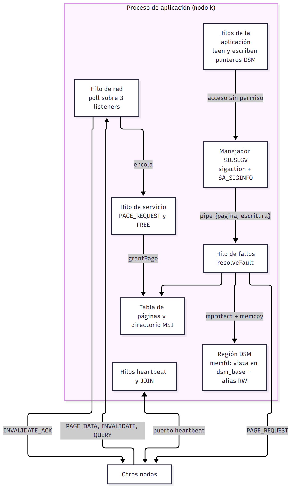
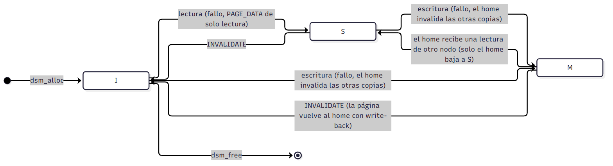
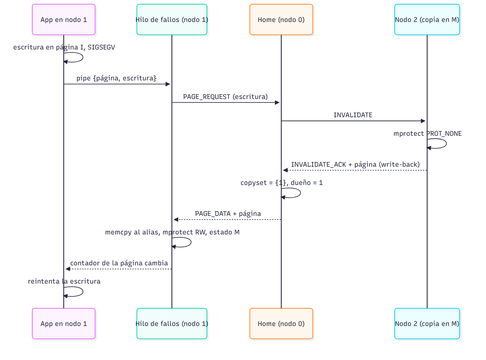

# 1. Introducción

El proyecto construye un sistema de Memoria Compartida Distribuida (DSM) en espacio de usuario para Linux [1]. Varios procesos, en la misma computadora o en computadoras distintas, ven un único rango de direcciones virtuales. Cuando un proceso toca una página que no tiene, el sistema operativo genera un fallo de página, el DSM pide la página por la red al nodo que la administra y el acceso se repite. La idea sigue la memoria virtual compartida de Li y Hudak [2] y reutiliza el mecanismo de paginación bajo demanda del sistema operativo [3].

Este informe describe la versión final: módulos, estructuras de datos, manejo de memoria y señales, protocolo de coherencia MSI, protocolo de mensajes, concurrencia y prevención de interbloqueos, API, aplicaciones de prueba, resultados y manual de uso. El código está en la carpeta `Entrega Final` del repositorio https://github.com/Serzc/Proyecto_SO.

# 2. Arquitectura general

Cada proceso que llama a `dsm_init` es un nodo par; no hay un servidor central. Todos los nodos leen el mismo archivo `dsm.conf`, y la posición de cada línea `host` define el `node_id`. El espacio DSM tiene `num_hosts × pages_per_node` páginas. La página global p tiene como home al nodo `p / pages_per_node`, y ese nodo guarda su directorio: el dueño actual y el conjunto de nodos con copia (copyset).

Cada nodo abre tres puertos TCP: datos (`port_base + 3k`), control (`port_base + 3k + 1`) y heartbeat (`port_base + 3k + 2`). Las operaciones del DSM viajan por el puerto de control; el de heartbeat solo lleva los latidos que marcan a cada nodo EN LÍNEA o CAÍDO.

{width=85%}

La Figura 1 muestra los hilos de un nodo. Los hilos de la aplicación usan punteros DSM como memoria normal. Un acceso sin permiso produce `SIGSEGV`; el manejador pasa la página al hilo de fallos, que la resuelve con el home y cambia la protección. El hilo de red atiende los mensajes entrantes, y el hilo de servicio ejecuta las solicitudes que necesitan esperar a otros nodos.

# 3. Módulos y archivos

| Archivo | Responsabilidad |
|---|---|
| `dsm.h` | API pública en C |
| `dsm_internal.h` | Constantes, tipos del protocolo, `NodeTable` y la clase `Node` |
| `config.cpp` | Lectura y validación de `dsm.conf`, resolución de hosts, puertos por nodo |
| `protocol.cpp` | Codificación del encabezado y de enteros en orden de red |
| `node.cpp` | Arranque y cierre del nodo, asignación y liberación en el home, consultas |
| `network.cpp` | Listeners, lectura y validación de frames, despacho, solicitudes pendientes, heartbeat, JOIN, hilo de servicio, consultas remotas |
| `pager.cpp` | Región DSM, protecciones, manejador de `SIGSEGV`, hilo de fallos, directorio MSI |
| `dsm.cpp` | Funciones del API en C sobre el nodo del proceso |
| `main.cpp` | Programa `dsmnode` con la consola de consulta |
| `apps/` | Aplicaciones `wordcount` y `matmul` |
| `test_memoria.cpp`, `test_coherencia.cpp` | Pruebas automáticas |
| `Makefile` | Compila `libdsm.a`, los programas y las pruebas |

Los módulos de C++ forman la biblioteca `libdsm.a`. Las aplicaciones están escritas en C y solo incluyen `dsm.h`.

# 4. Estructuras de datos

| Estructura | Tamaño | Uso |
|---|---|---|
| `MsgHeader` | 16 bytes | Encabezado de cada frame: tipo, emisor, estado, banderas, secuencia, página y largo de la carga |
| `NodeInfo` | 16 bytes | IPv4, primera página, cantidad de páginas, `node_id` y estado de un nodo |
| `PageEntry` | 16 bytes | Proceso dueño, copyset (un bit por nodo), orden dentro de la asignación, estado MSI local y dueño |
| `NodeStats` | 32 bytes | Páginas totales y libres, copias en M/S/I, fallos, páginas enviadas y recibidas |
| `Config` | 2080 bytes | Parámetros de `dsm.conf` y hasta 32 hosts |
| `Pending` | variable | Solicitud en espera: secuencia, destino, tipo de respuesta, variable de condición y carga recibida |
| `Allocation` | 12 bytes | Rango asignado y proceso dueño, en el home y en el nodo que asignó |

La tabla de páginas tiene una entrada por página del sistema. En las páginas de las que el nodo es home, la entrada también es el directorio (dueño y copyset). En las demás solo importa el estado de la copia local. Para el nodo local, los contadores M/S/I cuentan sus copias de todas las páginas del sistema.

# 5. Memoria, protecciones y señales

## 5.1 Reserva de la región

Al iniciar, el nodo crea un `memfd` del tamaño de todo el espacio DSM y lo mapea dos veces [4]. La vista de las aplicaciones queda fija en `dsm_base` con `MAP_FIXED_NOREPLACE` y protección `PROT_NONE`, así que la misma página tiene la misma dirección en todos los nodos. La segunda vista es un alias de lectura y escritura que solo usa el nodo para copiar páginas que llegan o salen sin abrir la protección de la vista pública.

## 5.2 Protecciones por estado

| Estado MSI | Protección | Significado |
|---|---|---|
| I (Invalid) | `PROT_NONE` | No hay copia válida; cualquier acceso falla |
| S (Shared) | `PROT_READ` | Copia de solo lectura; puede haber otras |
| M (Modified) | `PROT_READ \| PROT_WRITE` | Copia única con permiso de escritura |

Cada cambio de estado pasa por `setLocalState`, que llama a `mprotect` y actualiza las estadísticas.

## 5.3 Manejador de SIGSEGV

El manejador se registra con `sigaction` y `SA_SIGINFO` [4]. Lee la dirección exacta de `si_addr`, calcula la página y obtiene el tipo de acceso del bit de escritura del registro de error (`REG_ERR`, Linux x86_64). Si la dirección no es del DSM, restaura el manejador anterior y el proceso termina con un segmentation fault normal.

Un manejador de señales no puede tomar mutex ni usar sockets. Por eso solo usa operaciones async-signal-safe: escribe `{página, escritura}` en un pipe y espera con `nanosleep` a que cambie un contador atómico de esa página. El hilo de fallos lee el pipe, resuelve el fallo con mutex y red, cambia la protección e incrementa el contador. El manejador retorna y el CPU repite la instrucción, que ahora tiene permiso. Si el fallo no se pudo resolver (página no asignada u home sin respuesta), el manejador restaura el manejador anterior y el reintento termina el proceso.

# 6. Coherencia MSI

{width=100%}

El protocolo usa un directorio en el home e invalidación con write-back. La Figura 2 muestra las transiciones de una copia. El home atiende cada solicitud en `grantPage`, protegido por `directory_mutex_`:

1. Si otro nodo tiene la página en M, el home le envía `INVALIDATE`. Ese nodo baja a I y devuelve el contenido en `INVALIDATE_ACK`, que el home copia a su memoria.
2. En una lectura, el solicitante se agrega al copyset. Si el home tenía la página en M, baja a S para no escribir sobre una página compartida.
3. En una escritura, el home invalida todas las copias menos la del solicitante (incluida la propia) y lo registra como dueño único.
4. El home responde con `PAGE_DATA` y el contenido de la página. El solicitante la copia por el alias y aplica S o M.

Las faltas sobre páginas propias del home siguen el mismo camino sin mensajes de ida y vuelta.

{width=80%}

Un caso borde aparece porque cada frame usa su propia conexión TCP: un `INVALIDATE` puede procesarse antes que el `PAGE_DATA` que pretende revocar. Para cubrirlo, el hilo de fallos marca la página como "en solicitud" antes de enviar `PAGE_REQUEST`. Si llega un `INVALIDATE` mientras tanto, la marca cambia y el `PAGE_DATA` se descarta; el acceso falla otra vez y se pide una copia nueva. Si el home recibe luego una solicitud del nodo que figura como dueño, entiende que ese nodo descartó la copia sin escribirla y usa su propia copia, que sigue vigente.

`dsm_free` invalida todas las copias remotas antes de liberar las páginas. El home las llena con ceros para que una asignación posterior no vea datos del proceso anterior.

# 7. Protocolo de mensajes

Cada frame es un encabezado de 16 bytes seguido de la carga. Los campos se codifican uno por uno en orden de red: `type` (1 byte), `sender` (1), `status` (1), `flags` (1), `seq` (4), `page` (4) y `payload_len` (4). Al recibir, el nodo valida el emisor, el canal, el tipo, el estado, la página y el largo exacto de la carga para ese tipo; un frame inválido se descarta.

| Tipo | Código | Dirección | Carga |
|---|---|---|---|
| `JOIN` / `JOIN_ACK` | 1 / 2 | nodo nuevo <-> cada par | ninguna |
| `HEARTBEAT` | 3 | todos <-> todos (puerto heartbeat) | ninguna |
| `PAGE_REQUEST` | 4 | solicitante -> home | 4 bytes: 0 lectura, 1 escritura |
| `PAGE_DATA` | 5 | home -> solicitante | página completa, o estado inválido sin carga |
| `INVALIDATE` | 6 | home -> nodo con copia | ninguna |
| `INVALIDATE_ACK` | 7 | nodo -> home | página si estaba en M, si no ninguna |
| `ALLOC_REQUEST` / `ALLOC_REPLY` | 8 / 9 | nodo -> home | cantidad y proceso / primera página |
| `FREE` / `FREE_REPLY` | 10 / 13 | nodo -> home | primera página, cantidad y proceso |
| `QUERY_REQUEST` / `QUERY_REPLY` | 11 / 12 | cualquiera -> nodo consultado | tipo, primera página, cantidad / 32 bytes de estadísticas o 16 bytes por página |

Cada solicitud lleva un número de secuencia y se registra en la tabla de pendientes. La respuesta con esa secuencia, el emisor esperado y el tipo esperado despierta al hilo que espera. Si no llega antes de `timeout_ms`, la operación devuelve `DSM_E_TIMEOUT`.

# 8. Concurrencia e interbloqueos

## 8.1 Hilos

| Hilo | Función |
|---|---|
| Red | Un `poll` sobre los tres listeners y las conexiones aceptadas; lee frames, valida y despacha |
| Servicio | Atiende `PAGE_REQUEST` y `FREE`, que pueden esperar respuestas de otros nodos |
| Fallos | Atiende los fallos que llegan por el pipe, uno a la vez |
| Heartbeat | Envía latidos y marca como caídos a los nodos en silencio |
| JOIN | Anuncia el nodo a los pares que aún no respondieron |
| Aplicación | Los del programa que usa el API |

## 8.2 Sincronización

No se usan semáforos POSIX. Las esperas se hacen con mutex y variables de condición de C++, que cumplen el mismo papel: la tabla de pendientes usa `pending_mutex_` y una variable de condición por solicitud, y la cola del hilo de servicio usa `service_mutex_` y `service_ready_`. La tabla de páginas usa `page_table_mutex_`, el directorio `directory_mutex_`, la tabla de nodos su propio mutex y la tabla de asignaciones `allocations_mutex_`. Entre el manejador de señales y el hilo de fallos solo hay un pipe y contadores atómicos sin locks.

## 8.3 Cómo se evitan los interbloqueos

La regla principal es que el hilo de red nunca espera a otro nodo. Todas las respuestas llegan por ese hilo; si se bloqueara esperando una respuesta, nadie la entregaría. Por eso `INVALIDATE` y `QUERY_REQUEST` se responden en el acto con datos locales, mientras que `PAGE_REQUEST` y `FREE`, que pueden necesitar invalidaciones, pasan al hilo de servicio.

Entre nodos no se forman ciclos de espera: un nodo puede esperar a un home (por una página) y un home puede esperar a otros nodos (por invalidaciones), pero las invalidaciones las responde el hilo de red del otro nodo, que no espera a nadie.

Los mutex se toman siempre en el mismo orden: `directory_mutex_`, después `page_table_mutex_` y por último el de la tabla de nodos. Ningún hilo espera a la red mientras tiene `page_table_mutex_`. El manejador de señales no toma ningún mutex, así que un hilo de aplicación detenido dentro del manejador nunca bloquea a otro.

# 9. API

| Función | Descripción |
|---|---|
| `int dsm_init(const char* config, int node_id)` | Lee la configuración, reserva la región, instala el manejador y arranca los hilos |
| `void dsm_shutdown(void)` | Detiene los hilos, restaura el manejador y libera la región |
| `int dsm_alloc(size_t size, uint16_t proc, void** ptr)` | Une el nodo al segmento compartido del proceso `proc`; el mismo `proc` da la misma región en cualquier nodo |
| `int dsm_free(void* ptr)` | Separa el nodo del segmento; el último que lo suelta lo libera e invalida las copias |
| `int dsm_nodes(dsm_node_t* out, int max)` | Tabla de nodos |
| `int dsm_stats(int node_id, dsm_stats_t* out)` | Estadísticas de cualquier nodo en línea |
| `int dsm_page_table(int node_id, uint32_t first, uint32_t count, dsm_page_t* out)` | Tabla de páginas de un home, hasta 256 entradas |
| `void* dsm_page_address(uint32_t page)` | Dirección de una página global |
| `size_t dsm_page_size(void)`, `const char* dsm_strerror(int err)` | Utilidades |

Los errores son negativos: `DSM_E_INVAL`, `DSM_E_CONFIG`, `DSM_E_NOMEM`, `DSM_E_BADADDR`, `DSM_E_NODE_DOWN`, `DSM_E_TIMEOUT` y `DSM_E_NET`.

Una asignación es un segmento compartido identificado por `proc`, como un segmento de `shm_open`. Su home es siempre `proc % nodos`, así que todos los nodos le piden al mismo home y ninguno tiene que crearlo primero: el home busca el segmento y crea uno nuevo solo si no existe, todo bajo el mismo mutex, de modo que dos pedidos simultáneos reciben la misma región. El home guarda en la asignación un bit por nodo unido. `dsm_free` borra el bit del nodo y libera las páginas cuando no queda ninguno, así ningún nodo pierde memoria que otro todavía lee.

Si el segmento no cabe en la memoria del home ancla (`proc % nodos`), el nodo que lo pide consigue el resto en los nodos siguientes. Los rangos de páginas de los nodos son contiguos en la numeración global (el nodo k tiene las páginas `k * pages_per_node` a `(k + 1) * pages_per_node - 1`), así que el ancla toma las páginas libres del final de su rango y el segmento sigue al principio del rango del nodo siguiente, y así hasta completar el tamaño pedido. La dirección del segmento queda continua y cada parte la administra su propio home, con su directorio MSI. `ALLOC_REQUEST` tiene dos formas: la del ancla (cantidad y proceso), que responde la primera página y cuántas páginas tomó, y la de continuación (además, la primera página exacta y el orden de su primera página dentro del segmento). Los nodos que se unen después hacen los mismos pedidos y encuentran las partes ya reservadas. `dsm_free` suelta la parte de cada home. Si algún nodo siguiente no tiene lugar o está caído, se sueltan las partes ya reservadas y `dsm_alloc` devuelve `DSM_E_NOMEM`. Un pedido más grande que la memoria de todo el sistema también devuelve `DSM_E_NOMEM`.

# 10. Aplicaciones de prueba

No hay coordinador ni servidor: todos los nodos son iguales y ejecutan el mismo comando (`run matmul <a> <b>` o `run wordcount <archivo>`) con los mismos archivos de entrada. Las dos aplicaciones siguen el mismo esquema:

1. Cada nodo se une al segmento compartido de la aplicación con `dsm_alloc`. Las primeras páginas del segmento son de control, una por nodo.
2. Cada nodo copia al segmento su parte de los datos de entrada.
3. Barrera: cada nodo anota la fase en su página de control y espera a que todos los nodos lleguen. La espera lee copias S locales; cuando otro nodo escribe su fase, la invalidación obliga a pedir la página otra vez, así que no hace falta otro mecanismo de sincronización.
4. Cada nodo calcula su parte leyendo datos que cargaron otros nodos y deja el resultado en el segmento.
5. Barrera. Cada nodo lee el resultado completo, lo compara con un cálculo secuencial hecho con su copia local de los archivos e imprime el veredicto. Todos imprimen lo mismo.
6. Barrera final y `dsm_free`; el último nodo en salir libera el segmento.

`wordcount` cuenta palabras, líneas y letras de un texto. Cada nodo carga su tramo de bytes y cuenta el tramo que cargó el nodo siguiente, así siempre lee páginas escritas por otro. Una palabra cuenta en el tramo donde empieza, aunque para saberlo lea el byte anterior en otra página. El archivo de prueba es el enunciado del proyecto en texto plano (`data/enunciado_dsm.txt`, 15 905 bytes).

`matmul` calcula C = A × B con matrices leídas de archivo (`data/matriz_a.txt` y `data/matriz_b.txt`, 96 × 96). Cada nodo carga su bloque de filas de A y de B y calcula su bloque de filas de C. Para eso lee B completa, así que trae por la red las filas que cargaron los demás. Los bloques de C que comparten una página obligan a invalidaciones y write-back entre nodos, lo que ejercita la coherencia.

# 11. Pruebas y resultados

`make test` ejecuta dos pruebas automáticas. `test_memoria` usa un nodo y comprueba que una lectura deja la página en S, que una escritura la pasa a M, que los accesos con permiso no generan fallos, que liberar devuelve las páginas a I en cero y que la región se puede crear de nuevo. `test_coherencia` usa dos procesos: el nodo 1 lee datos que el nodo 0 escribió, escribe en la misma página, el nodo 0 lee esos cambios (write-back), el nodo 0 escribe e invalida la copia del nodo 1, y el nodo 1 consulta las estadísticas y la tabla de páginas del nodo 0 por la red. La prueba se repitió cinco veces seguidas sin fallos.

Con tres nodos en una misma computadora (`apps/local3.conf`) se obtuvo:

| Aplicación | Resultado | Verificación |
|---|---|---|
| `wordcount` | 2180 palabras, 246 líneas; letras más frecuentes e = 1502, a = 1236, o = 975, s = 952, r = 782 | CORRECTA |
| `matmul` | C[0][0] = 28.7452, C[95][95] = 4.5012, suma de C = 9787.8401 | CORRECTA (0 de 9216 celdas distintas) |

Los tres nodos imprimieron los mismos resultados. `test_coherencia` además reserva un segmento de 20 páginas con 16 páginas por nodo: el nodo 0 aporta las páginas 2 a 15 y el nodo 1 las 16 a 21, y los dos nodos leen y escriben a ambos lados del límite.

## 11.1 Rendimiento

`make bench` corre las tres aplicaciones con 1, 2 y 3 nodos en una misma computadora (un proceso por nodo, 4 MB por nodo, 4 pthreads por nodo) y cada nodo mide tres tiempos: la carga de sus datos al DSM, el cálculo distribuido (entre la primera y la segunda barrera) y el mismo cálculo completo hecho localmente sin DSM. Para un escenario con mucha memoria, `wordcount` usa `data/texto_grande.txt`, el enunciado repetido 400 veces (6.4 MB), y `imgfilter` la foto de 1280 x 1288 (6.4 MB en el DSM entre entrada y salida). La tabla resume el nodo 0 de una ejecución en una computadora con WSL2:

| Aplicación | Nodos | Memoria en el DSM | Carga | Cálculo distribuido | Secuencial local | Fallos (nodo 0) |
|---|---|---|---|---|---|---|
| `matmul` 96 x 96 | 1 | 216 KB | 7.7 ms | 1.6 ms | 0.8 ms | 56 |
| `matmul` 96 x 96 | 2 | 216 KB | 8.8 ms | 10.6 ms | 0.8 ms | 51 |
| `matmul` 96 x 96 | 3 | 216 KB | 9.3 ms | 10.3 ms | 0.9 ms | 64 |
| `wordcount` 6.4 MB | 1 | 6.4 MB | no cabe (4 MB) | | | |
| `wordcount` 6.4 MB | 2 | 6.4 MB (4 MB en el nodo 0, 2.4 MB en el nodo 1) | 197 ms | 220 ms | 16.7 ms | 1561 |
| `wordcount` 6.4 MB | 3 | 6.4 MB (4 MB en el nodo 1, 2.4 MB en el nodo 2) | 193 ms | 246 ms | 17.5 ms | 1044 |
| `imgfilter` 1280 x 1288 | 1 | 6.4 MB | no cabe (4 MB) | | | |
| `imgfilter` 1280 x 1288 | 2 | 6.4 MB | 122 ms | 19 ms | 41 ms | 1015 |
| `imgfilter` 1280 x 1288 | 3 | 6.4 MB | 155 ms | 45 ms | 42 ms | 953 |

Con un solo nodo, `wordcount` e `imgfilter` no se pueden ejecutar: necesitan 6.4 MB y un nodo aporta 4 MB. Con dos o tres nodos funcionan, y en `wordcount` el segmento del texto ocupa memoria de dos nodos.

En una sola computadora el DSM no acelera el cálculo: todos los nodos comparten los mismos núcleos y cada fallo de página cuesta un viaje por TCP local, de unos 0.1 a 0.2 ms, frente a nanosegundos de un acceso a memoria. En `wordcount` cada página se lee una sola vez y casi no se reutiliza, así que el tiempo es casi todo fallos (1561 fallos en 220 ms). `imgfilter` con 2 nodos es la excepción: cada nodo filtra su banda con 4 pthreads y la mayoría de las páginas que lee son de su propia banda, así que el cálculo distribuido (19 ms) es más rápido que el secuencial de un solo hilo (41 ms). Con 3 nodos hay más bordes entre bandas y más páginas remotas, y la ventaja desaparece. En el laboratorio, con computadoras distintas, el cálculo de cada nodo usa su propio procesador, pero cada fallo cuesta un viaje por la red física; las mismas mediciones se repiten con `bench.sh` adaptando `dsm.conf`.

La demostración final se hará en computadoras distintas del laboratorio, con un `dsm.conf` que liste sus direcciones IPv4.

# 12. Manual de usuario

1. Copiar la carpeta `EntregaFinal` en cada máquina y ejecutar `make`.
2. Editar `dsm.conf` con la IPv4 de cada máquina, en el mismo orden en todas, y abrir los puertos `port_base` a `port_base + 3n - 1`.
3. En cada máquina, iniciar el nodo con su `node_id`: `./dsmnode dsm.conf k`.
4. En la consola de cada nodo, escribir el mismo comando: `run matmul data/matriz_a.txt data/matriz_b.txt` o `run wordcount data/enunciado_dsm.txt`. Deben participar todos los nodos de `dsm.conf`.
5. `stats` muestra las estadísticas de todo el sistema. `pages` abre una vista por nodo (flechas para cambiar de nodo, `q` para salir) con la memoria usada y libre, un mapa de páginas por proceso y las asignaciones. `monitor` muestra los mensajes recibidos y los cambios de estado de los nodos sin interrumpir la consola (Enter para salir). `nodes` muestra qué nodos están en línea.

El archivo `README.md` tiene la tabla completa de parámetros y comandos.

# 13. Limitaciones

Un nodo que no responde un `INVALIDATE` se da por caído y sin copia; si solo estaba lento, la coherencia de esa página se rompe. Si el home de una página se cae, sus datos se pierden porque no hay replicación. Un acceso a una página no asignada, o cuyo home no responde, termina el proceso. La detección de lectura o escritura depende del registro de error de x86_64. Un segmento que no cabe en su home ancla sigue solo en los nodos siguientes (de número mayor) y no da la vuelta al nodo 0, así que un ancla cerca del último nodo tiene menos espacio para crecer; además, si el ancla no tiene páginas libres al final de su rango, el segmento no se reparte aunque haya espacio en otros nodos. Las aplicaciones esperan a todos los nodos de la configuración; si una corrida se interrumpe, su segmento queda reservado hasta reiniciar los nodos. Los extras del enunciado (ejecución distribuida de procesos y redundancia ante caídas) no se implementaron.

# 14. Conclusiones

El DSM cumple con lo pedido en el enunciado: memoria reservada con `mmap`, protección por página con `mprotect`, fallos capturados con `sigaction`, coherencia MSI con invalidación y write-back, consultas de estado desde cualquier nodo y dos aplicaciones independientes que producen resultados verificados.

La decisión que más influyó en el diseño fue no esperar nunca a la red desde el hilo que recibe las respuestas. Separar el hilo de servicio y el hilo de fallos evitó interbloqueos sin agregar timeouts artificiales. La otra decisión importante fue mantener el manejador de señales mínimo: un pipe y un contador atómico bastan para sacar el trabajo del contexto de la señal.

Las aplicaciones no tienen coordinador: los segmentos compartidos con conteo de nodos unidos y las barreras sobre páginas de control bastan para que nodos iguales cooperen sin que ninguno tenga un papel especial.

El costo del DSM se ve en los contadores: en `matmul`, cada página de C que dos nodos comparten viaja varias veces entre ellos. Asignar a cada nodo bloques alineados a página reduciría ese tráfico.

# Bibliografía

[1] E. Arias Méndez, "Proyecto Programado: Implementación de un Sistema de Memoria Compartida Distribuida (DSM) con Paginación bajo Demanda y Coherencia MSI," IC-6600 Principios de Sistemas Operativos, Escuela de Ingeniería en Computación, Instituto Tecnológico de Costa Rica, Cartago, Costa Rica, Oct. 2026.

[2] K. Li and P. Hudak, "Memory coherence in shared virtual memory systems," ACM Trans. Comput. Syst., vol. 7, no. 4, pp. 321-359, Nov. 1989.

[3] A. Silberschatz, P. B. Galvin, and G. Gagne, Operating System Concepts, 9th ed. Hoboken, NJ, USA: John Wiley & Sons, 2013.

[4] M. Kerrisk, "The Linux man-pages project: mmap(2), mprotect(2), memfd_create(2), sigaction(2)," man7.org. [Online]. Available: https://man7.org/linux/man-pages/. Accessed: Nov. 21, 2026.
